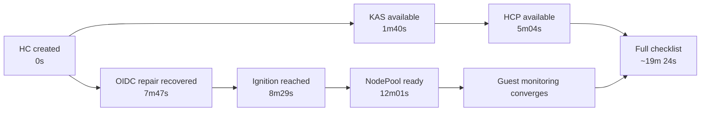

# AWS Startup Observation (5.0.0-rc.7)

This run validates the [startup roadmap](cluster-startup-roadmap.md) against an
AWS HostedCluster created on 28 October 2026. It is a debugging example, not a
performance baseline: it includes an operator rollout and a repaired OIDC
credential configuration.

## Run configuration

| Setting | Value |
|---------|-------|
| Release | `quay.io/openshift-release-dev/ocp-release:5.0.0-rc.7-multi` |
| HO image | `quay.io/acm-d/rhtap-hypershift-operator@sha256:d7eb652dbbfac8ae9866b413c7125c86961a5cfb46396eb31774e0b3e171a3a5` |
| HO source | `d1790a739bfc51d115968f11a93e66e87dc5ec7c` |
| Release CPO source | `b9d6ae1c63453c012e889525eb924b3a07bac26b` |
| AWS region / worker zone | `us-east-1` / `us-east-1a` |
| Workers | Two `m5.large` instances, one NodePool |
| Availability policies | Controller and infrastructure `SingleReplica` |
| Endpoint access | `Public` |
| Management cluster | Nine Ready workers, Kubernetes `v1.34.2`; no existing HostedClusters |
| HostedCluster creation (`t=0`) | `2026-10-28T19:15:46Z` |

The copied AWS scripts installed HO and created the cluster. CLI infrastructure
provisioning began at `19:15:17Z`, **29 seconds before** HostedCluster creation.
That interval is outside the P0–P9 clock.

The previous HO leader handled the first approximately 47 seconds while the
requested image finished rolling out and acquired leadership. This limits timing
comparisons for initial validation and scaffolding. The copied install script
now waits for the rollout before returning.

## Milestones

Times below are the first successful transitions captured in this run.
`~` means the first polling observation rather than an API transition timestamp.
The requested polling delay was ten seconds, plus query time. An early guest API
discovery retry delayed one cycle; the collector was changed to direct API paths
with short timeouts. Collector restarts retained the observations and recovered
first-seen timestamps.

| Stage | Milestone | Elapsed from HC creation |
|-------|-----------|--------------------------|
| P0 | Validation passed | 1s |
| P1 | HostedControlPlane created | 2s |
| P1 | Management operators deployed | 3s |
| P2 | HCP InfrastructureReady | 28s |
| P3 | featuregate-generator ready | 33s |
| P3 | etcd available | 1m 15s |
| P4 | Kube API server available | 1m 40s |
| P4 | HostedCluster kubeconfig published | ~2m 31s |
| P6 | Node bootstrap payload generated | 4m 51s |
| P5 | HostedControlPlane available | 5m 04s |
| P5 | Control-plane rollout complete | 5m 52s |
| P5 | HostedCluster available | 6m 37s |
| P6 | MachineDeployment or MachineSet created | 8m 01s |
| P7 | First CAPI Machine created | 8m 05s |
| P7 | Ignition endpoint reached | 8m 29s |
| P8 | All CAPI Machines ready | 12m 01s |
| P8 | All CAPI Nodes healthy | 12m 01s |
| P8 | NodePool ready | 12m 01s |
| P9 | Guest ClusterVersion complete | 19m 19s |
| P9 | HostedCluster version Completed | 19m 19s |
| P9 | Guest ClusterOperators converged | 19m 02s |
| P9 | Full completion checklist | ~19m 24s |

This shows observed milestones and overlapping workstreams, rather than every
controller dependency. HCP availability preceded OIDC recovery in this run.

## OIDC interruption and recovery

After the API started, `ValidOIDCConfiguration` became false at **+2m25s**.
The HO could not upload OIDC documents to S3. Its logs showed credential
resolution falling back to EC2 IMDS.

The installation script had passed STS JSON to
`--oidc-storage-provider-s3-credentials`, whose SDK input is a shared AWS INI
profile. The STS session itself was valid. The copied script was changed to
write an INI profile, including the session token, then reinstall and restart
HO. OIDC validation recovered at **+7m47s**. Workers were provisioned after
that recovery; these timings include the repair and are not a clean launch
benchmark.

This explains an otherwise confusing state: HCP and HostedCluster availability
could become true while OIDC validation still blocked worker setup. The
roadmap's first false gate returned to P0 even though control-plane resources
already existed.

## What the observation clarified

- Cloud provisioning before HC creation needs a separate clock.
- CAPA initially waited for `service-network-admin-kubeconfig`; its early
  unready pod did not prevent endpoint publication, etcd, or KAS startup.
- Ignition components started before KAS; most other components followed KAS.
- NodePool payload generation overlapped control-plane convergence.
- HCP availability, HostedCluster availability, worker readiness, and guest
  convergence were distinct milestones.
- After ignition was reached, worker consoles showed Machine Config Daemon
  first-boot work and a reboot before Node registration. Ignition success did
  not prove kubelet readiness.
- Guest operators with unknown or missing conditions must remain pending;
  completion requires explicit `Progressing=False` and `Degraded=False`.

## Final guest-operator wait

After both workers became ready at **+12m01s**, monitoring was the last guest
ClusterOperator to converge. Its first reconciliation hit missing RBAC
dependencies: `monitoring-alertmanager-edit` for the Prometheus Alertmanager
RoleBinding, and `cluster-monitoring-view` for Telemeter. Prometheus creation
stopped before the Prometheus custom resource existed. The task still ran its
availability validation, producing a five-minute wait before the retry at
`19:34:18Z`.

The retry created the missing resources and the Prometheus instance without
manual intervention. Most monitoring pods had already been healthy during this
wait. Inspecting only existing pods would have hidden the missing operand and
the unfinished task. For this state, inspect the monitoring ClusterOperator,
CMO task errors, and `oc get prometheuses -n openshift-monitoring` before
assuming a scheduling or cloud credential problem.

## Control-plane component timings

These are each component's first captured `Available=True` and
`RolloutComplete=True` condition transitions. They are separate from HCP
aggregation and guest ClusterOperator convergence. A component can later roll
again as configuration converges.

| Component | First available | First rollout complete |
|-----------|-----------------|------------------------|
| `aws-cloud-controller-manager` | 1m 50s | 1m 50s |
| `capi-provider` | 2m 25s | 3m 32s |
| `catalog-operator` | 2m 55s | 2m 55s |
| `certified-operators-catalog` | 2m 56s | 2m 56s |
| `cloud-credential-operator` | 4m 00s | 4m 00s |
| `cluster-api` | 7s | 7s |
| `cluster-autoscaler` | 1m 41s | 1m 41s |
| `cluster-image-registry-operator` | 3m 18s | 3m 18s |
| `cluster-network-operator` | 4m 01s | 5m 08s |
| `cluster-node-tuning-operator` | 2m 22s | 2m 22s |
| `cluster-policy-controller` | 2m 22s | 2m 22s |
| `cluster-storage-operator` | 2m 46s | 4m 01s |
| `cluster-version-operator` | 2m 30s | 2m 30s |
| `community-operators-catalog` | 2m 56s | 2m 56s |
| `control-plane-operator` | 4s | 4s |
| `control-plane-pki-operator` | 1m 45s | 1m 45s |
| `csi-snapshot-controller-operator` | 2m 46s | 3m 18s |
| `dns-operator` | 2m 54s | 2m 54s |
| `etcd` | 1m 17s | 1m 17s |
| `featuregate-generator` | 29s | 33s |
| `hosted-cluster-config-operator` | 2m 54s | 2m 54s |
| `ignition-server` | 31s | 31s |
| `ignition-server-proxy` | 33s | 33s |
| `ingress-operator` | 4m 02s | 4m 02s |
| `konnectivity-agent` | 1m 46s | 1m 46s |
| `kube-apiserver` | 1m 38s | 1m 38s |
| `kube-controller-manager` | 1m 41s | 1m 48s |
| `kube-scheduler` | 1m 41s | 1m 45s |
| `kube-storage-version-migrator` | 1m 44s | 1m 44s |
| `machine-approver` | 1m 45s | 1m 45s |
| `oauth-openshift` | 1m 59s | 3m 59s |
| `olm-collect-profiles` | 1m 40s | 1m 40s |
| `olm-operator` | 2m 55s | 2m 55s |
| `openshift-apiserver` | 1m 41s | 1m 54s |
| `openshift-controller-manager` | 2m 23s | 2m 23s |
| `openshift-oauth-apiserver` | 2m 00s | 2m 51s |
| `openshift-route-controller-manager` | 1m 59s | 2m 22s |
| `packageserver` | 2m 56s | 2m 56s |
| `redhat-operators-catalog` | 4m 45s | 4m 45s |

## Guest ClusterOperator convergence

For each operator, this is the first captured state with `Available=True`,
`Progressing=False`, and `Degraded=False`. The time is the latest of those three
condition transitions, or the first observation if a timestamp was absent.
An operator can later resume progressing as workers and configuration arrive;
the full checklist requires all operators to converge at the same time.

| Guest operator | First converged |
|----------------|-----------------|
| `cloud-credential` | 3m 45s |
| `console` | 13m 46s |
| `csi-snapshot-controller` | 2m 57s |
| `dns` | 12m 58s |
| `image-registry` | 3m 02s |
| `ingress` | 13m 53s |
| `insights` | 12m 19s |
| `kube-apiserver` | 2m 59s |
| `kube-controller-manager` | 2m 59s |
| `kube-scheduler` | 2m 59s |
| `kube-storage-version-migrator` | 12m 49s |
| `monitoring` | 19m 02s |
| `network` | 13m 14s |
| `node-tuning` | 11m 40s |
| `openshift-apiserver` | 2m 59s |
| `openshift-controller-manager` | 2m 59s |
| `openshift-samples` | 13m 42s |
| `operator-lifecycle-manager` | 2m 57s |
| `operator-lifecycle-manager-catalog` | 3m 28s |
| `operator-lifecycle-manager-packageserver` | 2m 59s |
| `service-ca` | 12m 50s |
| `storage` | 12m 08s |
