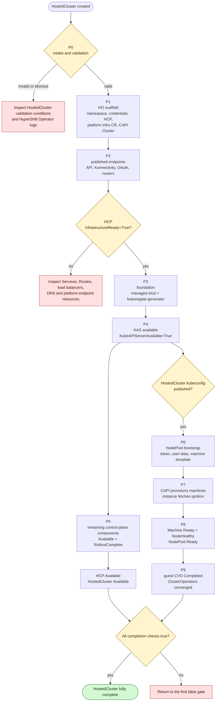
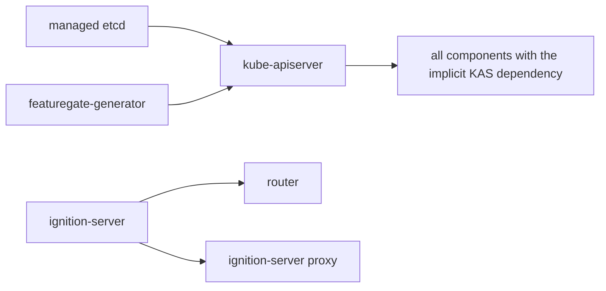
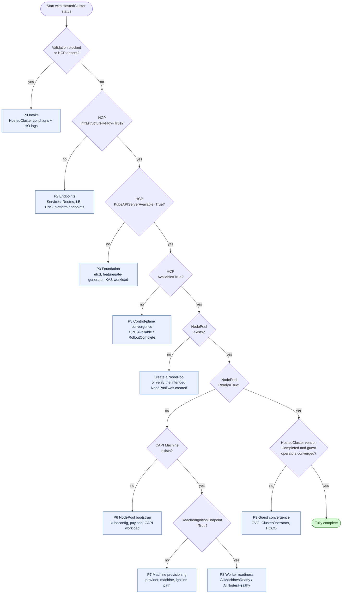

# Hosted Cluster Startup Roadmap

This page describes how a HostedCluster becomes ready, from the initial
`HostedCluster` API object through a converged guest cluster. It covers AWS and
self-managed Azure. ARO HCP is a managed service with a different provisioning
path and is not covered here.

For measured component timings and a real debugging example, see the
[AWS startup observation for 5.0.0-rc.7](cluster-startup-aws-observation.md).

The roadmap is derived from the controllers in this repository. It is a
debugging model, not a promise that reconciliation happens in a single serial
order. Several workstreams overlap:

- The HyperShift Operator (HO) continues scaffolding management-cluster
  resources while the Control Plane Operator (CPO) starts the control plane.
- CAPI infrastructure can continue provisioning while control-plane workloads
  are starting.
- NodePool bootstrap can begin as soon as the hosted API kubeconfig exists,
  before every control-plane component has finished rolling out.
- Guest ClusterVersion and ClusterOperator convergence continues after the
  NodePool reports ready.

Use the stage gates below to decide what must be true next. Use the measured
timestamps for performance analysis; do not infer ordering from wall-clock
timings alone.

!!! note "Existing SLO targets are not observed baselines"

    [SLOs](SLOs.md) defines CI targets such as HostedCluster availability in
    under five minutes, NodePool availability in under eight minutes, and full
    rollout in under fifteen minutes. Those are targets under a documented CI
    environment, not general AWS or Azure medians. Collect a baseline with the
    timeline tooling described in [Measuring startup](#measuring-startup)
    before making timing claims.

## What "ready" means

The word "ready" is overloaded. These signals answer different questions:

| Question | Authoritative signal | What it does not prove |
|----------|----------------------|------------------------|
| Are the published control-plane endpoints available? | HCP `InfrastructureReady=True` | The `AWSCluster` or `AzureCluster`, worker networks, or guest nodes are ready. |
| Is the hosted API server workload available? | HCP `KubeAPIServerAvailable=True` plus a successful KAS load-balancer health check | Every control-plane component is available. |
| Can the hosted API be used by the HO and NodePool controller? | `HostedCluster.status.kubeconfig` is populated | Workers have joined or the guest cluster has converged. |
| Is the hosted control plane available? | HCP `Available=True`, copied to HostedCluster `Available=True` | Any NodePool exists or is ready. |
| Has the management-side control plane completed its rollout? | HCP `status.controlPlaneVersion.history[0].state=Completed`, with every `ControlPlaneComponent` at the desired version and `RolloutComplete=True` | The guest ClusterVersion or ClusterOperators have converged. |
| Are the requested workers ready? | NodePool `Ready=True`, `AllMachinesReady=True`, and `AllNodesHealthy=True` | Every guest operator is stable or complete. |
| Is the guest release rollout complete? | HostedCluster `status.version.history[0].state=Completed` and desired image match | Every ClusterOperator is necessarily converged at that instant. |
| Is the cluster operationally complete? | The full checklist in [Full completion](#p9-guest-convergence-and-full-completion) | Nothing will ever change again. This is a point-in-time convergence check. |

!!! warning

    HostedCluster `Available=True` can be true while a NodePool is still
    provisioning. NodePool `Ready=True` can be true while the guest CVO is still
    progressing. HostedCluster `Progressing=False` alone is also not a
    completion check: the HO's `Progressing` condition mainly tracks whether the
    desired release image differs from the observed release.

## Startup dependency graph



The diagram shows hard gates, not exact execution order. For example, the CPO
can publish endpoints while CAPI is still creating cloud infrastructure, and the
NodePool controller can build bootstrap resources while OLM or another
control-plane component is still becoming available.

## Stage map

| Stage | Hard gate to leave the stage | Primary evidence | First place to investigate |
|-------|------------------------------|------------------|----------------------------|
| P0 Intake | HO accepts the HostedCluster configuration and release image | HostedCluster validation conditions; HCP may not exist yet | HostedCluster conditions and HO logs |
| P1 Scaffold | HCP, platform infrastructure CR, and CAPI `Cluster` exist; management operators are deployed | HCP and CAPI resources; HO deployments | HO logs, namespace events, credential Secrets |
| P2 Endpoints | HCP `InfrastructureReady=True` | HCP condition; Services, Routes, load balancers, DNS | HCP condition reason; endpoint resources; platform DNS/endpoint conditions |
| P3 Foundation | Managed etcd and featuregate-generator are ready | CPC status; etcd StatefulSet; featuregate Job; HCP `EtcdAvailable` | etcd pods, PVCs, events, certificates; featuregate Job |
| P4 KAS | KAS workload is available and the hosted kubeconfig is published | HCP `KubeAPIServerAvailable`; HCP kubeconfig; HostedCluster kubeconfig | KAS deployment, pods, Service/LB health, HCP status reason |
| P5 Control-plane convergence | Every CPC is available and rollout-complete at the desired version | CPC conditions; HCP `Available` and `controlPlaneVersion` | CPC dependency messages, deployment status, component operand status |
| P6 NodePool bootstrap | Bootstrap payload, token, machine template, and CAPI workload exist | NodePool conditions and Secrets; MachineDeployment or MachineSet | NodePool conditions, kubeconfig status, user-data/token Secrets, HO logs |
| P7 Machine provisioning | Cloud machine exists and at least one instance reaches ignition | CAPI Machine and platform machine; NodePool `ReachedIgnitionEndpoint` | CAPI provider logs, machine events, ignition DNS/endpoint, console logs |
| P8 Worker readiness | Machines are ready and nodes are healthy | NodePool `Ready`, `AllMachinesReady`, `AllNodesHealthy` | CAPI Machine conditions and NodePool aggregate messages |
| P9 Guest convergence | Guest CVO completes and ClusterOperators converge | HostedCluster `status.version`; guest CVO and ClusterOperators | Guest CVO, ClusterOperators, HCCO logs, HCP conditions |

## Before P0: Provisioning inputs

The roadmap clock starts when the HostedCluster API object is created. A create
command can already be provisioning infrastructure before that point.
For example, `hypershift create cluster aws` creates the VPC, subnets, NAT
gateway, DNS zones, OIDC configuration, and IAM roles before submitting the
HostedCluster, unless existing infrastructure and IAM inputs are supplied.

If the collector says "Waiting for HostedCluster", inspect the create command's
logs first. An AWS NAT gateway or IAM provisioning wait at this point is outside
P0; it cannot appear in HostedCluster conditions because the object does not
exist yet. The later `AWSCluster` resource represents the CAPI infrastructure
object, not the start of this CLI provisioning work.

Record two clocks when evaluating the whole user experience:

- Command start to HostedCluster creation: infrastructure and identity setup.
- HostedCluster creation to each readiness gate: the P0–P9 controller timeline.

Start the collector before running the create script so it captures the first
reconciliation after the object appears.

## P0: Intake and validation

The HO validates the HostedCluster before it can create a usable control plane.
The exact validation set depends on platform and capabilities, but common
conditions include:

- `ValidConfiguration`
- `SupportedHostedCluster`
- `ValidReleaseImage`
- `ValidIDPConfiguration`
- `ValidProxyConfiguration`
- AWS: `ValidAWSIdentityProvider`, `ValidAWSKMSConfig`, and related credential
  and endpoint conditions
- Azure: `ValidAzureKMSConfig` and workload-identity validation

If a blocking validation condition is false, the HO stops before the rest of
the startup chain. This appears as a HostedCluster condition or a blocked
`Progressing` reason, often before an HCP exists.

Validation also continues after the initial scaffold. For example, OIDC
document publication can fail after KAS has started, and AWS identity checks
can remain `Unknown` until KAS is available. A later
`ValidOIDCConfiguration=False` can therefore make P0 the first false gate while
P1–P4 resources already exist. Read the condition message and HO logs; this
does not mean those resources were removed or that startup is strictly serial.

For an AWS OIDC upload failure, distinguish the two credential file formats:
`create cluster aws --sts-creds` accepts STS JSON, while
`install --oidc-storage-provider-s3-credentials` supplies a shared AWS INI
profile to the HO SDK. Temporary credentials in that profile need
`aws_session_token` as well as the access key and secret key. An HO log showing
credential fallback to EC2 IMDS can indicate an unreadable or incorrectly
formatted profile; it does not necessarily mean the STS session expired.

Inspect:

```bash
oc get hostedcluster "$HC_NAME" -n "$HC_NAMESPACE" \
  -o json | jq -r '.status.conditions[]
  | [.type, .status, .reason, .message, .lastTransitionTime] | @tsv'

oc logs -n hypershift deployment/operator --tail=200
```

## P1: Management-cluster scaffold

After validation, the HO performs a critical reconciliation sequence:

1. Resolve the CPO image and create or update the control-plane namespace. The
   namespace name is `<hostedcluster-namespace>-<hostedcluster-name>`, with dots
   in the cluster name replaced by dashes.
2. Reconcile platform credentials, pull secret, and encryption configuration.
3. Run the sequential core chain: `HostedControlPlane` → platform
   infrastructure CR → CAPI `Cluster`.
4. Deploy the CPO, CAPI manager (`cluster-api`), CAPI provider
   (`capi-provider`), and optionally Karpenter.
5. Reconcile RBAC and network policies.

!!! note "HostedCluster namespaces can be shared"

    Multiple HostedCluster definitions can share the management-cluster
    namespace that contains the HostedCluster resources. Each HostedCluster
    still gets its own derived HostedControlPlane namespace,
    `<hostedcluster-namespace>-<hostedcluster-name>`. NodePools select their
    HostedCluster with `spec.clusterName`; the timeline collector uses that
    field to avoid mixing worker pools from unrelated HostedClusters.

    For per-cluster disaster recovery, OCPBUGS-61116 reports that restoring a
    backup which includes a shared HostedCluster namespace can also restore
    other HostedClusters' resources from that namespace. Use separate
    HostedCluster namespaces or cluster-specific backup filtering in that case.

The platform infrastructure CR is `AWSCluster` on AWS and `AzureCluster` on
self-managed Azure. Azure also creates an `AzureClusterIdentity`.

This stage is shared by AWS and Azure, but the credential and identity inputs
differ:

| Concern | AWS | Self-managed Azure |
|---------|-----|--------------------|
| Management identity | STS/OIDC federation and IAM roles; CAPA credential Secrets | Workload identities and federated credentials; `AzureClusterIdentity` |
| CAPI infrastructure | `AWSCluster` | `AzureCluster` plus `AzureClusterIdentity` |
| CAPI provider | CAPA (`capi-provider`) | CAPZ (`capi-provider`) |

Inspect:

```bash
oc get hostedcontrolplane "$HC_NAME" -n "$HCP_NAMESPACE" -o yaml
oc get cluster.cluster.x-k8s.io -n "$HCP_NAMESPACE"
oc get awscluster -n "$HCP_NAMESPACE"                 # AWS
oc get azurecluster,azureclusteridentity -n "$HCP_NAMESPACE"  # Azure
oc get deployment -n "$HCP_NAMESPACE" \
  control-plane-operator cluster-api capi-provider
oc get events -n "$HCP_NAMESPACE" --sort-by=.lastTimestamp
```

An existing HCP only proves that the API object was created. It does not prove
that the CPO is running or that the platform infrastructure is ready.

On AWS, the `capi-provider` pod can initially wait for the
`service-network-admin-kubeconfig` Secret. Its init container uses the guest API,
so the pod can remain unready while P2–P4 proceed. A transient `FailedMount`
event for that Secret is not by itself evidence that AWS credentials are wrong.
Check whether KAS is still being bootstrapped before treating this as a separate
provider failure.

## P2: Endpoint publication

The CPO first reconciles the infrastructure services used to publish the control
plane: API server, Konnectivity, OAuth when enabled, OpenShift API server, OLM
package server, and HCP router services. It then reads their status.

`InfrastructureReady=True` means the required published endpoint addresses are
available. It does not mean the `AWSCluster` or `AzureCluster` is ready. Cloud
network creation and CAPI reconciliation can still be in progress.

If the condition is false, read its reason and message first. Common reasons
point to:

- A missing or unpopulated load balancer
- A Service or Route that has not received an address
- A DNS hostname that does not resolve
- An API server or Konnectivity service with no published host/port
- A required internal or external router that is not ready

Platform-specific checks:

- AWS: KAS load balancer or Route, HCP router, endpoint services/PrivateLink,
  and managed or external DNS. Look for `AWSEndpointServiceAvailable`,
  `AWSEndpointAvailable`, `ExternalDNSReachable`, and `PublicEndpointExposed`
  conditions where applicable.
- Azure: KAS load balancer, DNS, and, for private clusters, the
  `AzurePrivateLinkService` status and private DNS resources. Azure KAS load
  balancing currently uses service port `7443` because `6443` collides with the
  management cluster's public load-balancer rule.

Inspect:

```bash
oc get hostedcontrolplane "$HC_NAME" -n "$HCP_NAMESPACE" \
  -o jsonpath='{range .status.conditions[?(@.type=="InfrastructureReady")]}{.status}{"\t"}{.reason}{"\t"}{.message}{"\n"}{end}'
oc get service,route -n "$HCP_NAMESPACE"
oc get events -n "$HCP_NAMESPACE" --sort-by=.lastTimestamp
oc logs -n "$HCP_NAMESPACE" deployment/control-plane-operator --tail=200
```

## P3: Foundation components

The CPO does not reconcile its component set until the published infrastructure
is ready. When it starts, the first dependency chain is:



`kube-apiserver` has explicit dependencies on managed etcd and
`featuregate-generator`. Most other components acquire an implicit dependency
on a fully available and rollout-complete KAS. The exceptions are:

- etcd
- featuregate-generator
- control-plane-operator
- cluster-api
- capi-provider
- karpenter and karpenter-operator
- router
- ignition-server
- ignition-server-proxy

Router still depends on ignition-server, and the ignition proxy also depends on
ignition-server.

!!! note

    Component registration order is not startup order. For example,
    `control-plane-pki-operator` is registered early but has the implicit KAS
    dependency, so it is not the first component to reconcile during initial
    startup.

Managed etcd is reported through HCP `EtcdAvailable`; KAS is reported through
HCP `KubeAPIServerAvailable`. The CPO computes both conditions from the existing
StatefulSet and Deployment before reconciling component updates, so a condition
can lag the workload by a reconcile cycle.

Inspect:

```bash
oc get controlplanecomponent -n "$HCP_NAMESPACE"
oc get controlplanecomponent etcd featuregate-generator kube-apiserver \
  -n "$HCP_NAMESPACE" -o yaml
oc get statefulset etcd -n "$HCP_NAMESPACE"
oc get pods -n "$HCP_NAMESPACE" -l app=etcd
oc get jobs,pods -n "$HCP_NAMESPACE" | grep featuregate
oc get events -n "$HCP_NAMESPACE" --sort-by=.lastTimestamp
```

For etcd, inspect PVC binding and storage events. For featuregate-generator,
inspect the Job and its pod logs.

## P4: Kube API server and kubeconfig

KAS becomes the critical junction for the rest of the cluster:

- Remaining control-plane components wait for KAS.
- The HO needs an HCP kubeconfig to publish `HostedCluster.status.kubeconfig`.
- The NodePool controller waits for `HostedCluster.status.kubeconfig` before it
  generates node bootstrap data.

`KubeAPIServerAvailable=True` comes from the KAS Deployment's `Available`
condition. HCP availability separately performs a health check against the
published KAS endpoint. A running pod with a broken Service, load balancer, DNS
record, or network path can therefore pass the deployment check and fail the
endpoint check.

These signals can become true and then false again during initial component
rollouts. Preserve the observations rather than using the latest condition's
`lastTransitionTime` as the first-ever availability time. Distinguish first
availability from the final rollout and the simultaneous completion checklist.

Once the KAS component creates its kubeconfig Secret, the CPO publishes it in
HCP status and the HO copies it to the HostedCluster namespace. NodePool
provisioning can start after this copy, even while P5 is still finishing.

Inspect:

```bash
oc get deployment kube-apiserver -n "$HCP_NAMESPACE"
oc get pods -n "$HCP_NAMESPACE" -l app=kube-apiserver
oc get hostedcontrolplane "$HC_NAME" -n "$HCP_NAMESPACE" \
  -o jsonpath='{.status.kubeConfig}{"\n"}{.status.controlPlaneEndpoint}{"\n"}'
oc get hostedcluster "$HC_NAME" -n "$HC_NAMESPACE" \
  -o jsonpath='{.status.kubeconfig}{"\n"}'
oc get events -n "$HCP_NAMESPACE" --sort-by=.lastTimestamp
```

For a failed endpoint health check, inspect the KAS Service, load balancer,
Route, DNS, and network policies. The HCP `Available` condition reason
`KASLoadBalancerNotReachable` is specific to this class of failure.

## P5: Control-plane convergence

After KAS, the remaining components reconcile according to their dependencies.
The OpenShift API server unlocks another large group, including OAuth, CVO, OCM,
DNS, ingress, registry, storage, NTO, and OLM. A component is gated on each
dependency being both:

- `Available=True`
- `RolloutComplete=True`
- Reporting the desired component version

HCP `Available=True` requires:

1. HCP `InfrastructureReady` is true.
2. HCP kubeconfig exists.
3. Managed etcd is available.
4. KAS is available.
5. The published KAS endpoint passes its health check.
6. Every `ControlPlaneComponent` in the namespace has `Available=True`.

The HCP check evaluates those conditions in priority order. Its reason and
message therefore identify the first actionable blocker. When the reason is
`ControlPlaneComponentsNotAvailable`, the message lists the affected component
names.

HostedCluster `Available` is copied from HCP `Available`, so it has the same
meaning. It is not a worker-readiness check.

For management-side rollout completion, use HCP
`status.controlPlaneVersion.history[0]`. `Completed` means every CPC
reported the desired version with `RolloutComplete=True`. This is stricter than
checking `Available` alone. In Go, the corresponding OpenShift API constant is
`configv1.CompletedUpdate`, but its serialized value is `Completed`.

Inspect:

```bash
oc get hostedcontrolplane "$HC_NAME" -n "$HCP_NAMESPACE" \
  -o jsonpath='{range .status.conditions[?(@.type=="Available")]}{.status}{"\t"}{.reason}{"\t"}{.message}{"\n"}{end}'
oc get controlplanecomponent -n "$HCP_NAMESPACE" -o wide
oc get controlplanecomponent -n "$HCP_NAMESPACE" \
  -o json | jq -r '.items[]
  | .metadata.name as $name
  | .status.conditions[]
  | select(.status != "True")
  | [$name, .type, .status, .reason, .message] | @tsv'
oc get deployment -n "$HCP_NAMESPACE"
oc get pods -n "$HCP_NAMESPACE"
```

Start with the newest false condition or rollout reason. `WaitingForDependencies`
identifies a dependency chain. `WaitingForOperands` means the primary workload
is ready but a child deployment is not.

## P6: NodePool bootstrap

The NodePool controller evaluates validation and rollout conditions before it
creates machine resources. Important conditions include:

- `ValidReleaseImage`
- `ValidPlatformImage`
- `ValidMachineConfig`
- `ValidPlatformConfig`
- `SupportedVersionSkew`
- `IgnitionEndpointAvailable`
- `UpdatingVersion`

`IgnitionEndpointAvailable` is normally removed from NodePool status when the
endpoint is healthy. Its presence with `False` is the actionable signal.

The controller then waits for `HostedCluster.status.kubeconfig`. Once present,
it generates the bootstrap configuration and reconciles:

- A token Secret and a user-data Secret, named with the configuration hash
- The platform machine template
- A CAPI `MachineDeployment` for `Replace` upgrades (the default)
- A CAPI `MachineSet` for `InPlace` upgrades

A new NodePool remains in an initial version rollout. `status.version` is set
only after the CAPI workload rollout completes, so an empty `status.version`
during initial provisioning is expected rather than evidence of corruption.

Inspect:

```bash
oc get nodepool -n "$HC_NAMESPACE"
oc describe nodepool "$NODEPOOL_NAME" -n "$HC_NAMESPACE"
oc get secret -n "$HCP_NAMESPACE" \
  -o json | jq -r '.items[].metadata.name
  | select(startswith("token-") or startswith("user-data-"))'
oc get machinedeployment,machineset -n "$HCP_NAMESPACE"
oc get machines -n "$HCP_NAMESPACE"
oc get events -n "$HCP_NAMESPACE" --sort-by=.lastTimestamp
```

Never print or paste Secret data while debugging. Names, creation timestamps,
and annotations are sufficient for this stage.

If no machine workload exists, first confirm that the HostedCluster kubeconfig
is populated, then check the NodePool conditions and the HO logs for machine
template or bootstrap errors.

## P7: Cloud machine and ignition

The CAPI manager creates `Machine` objects and the platform CAPI provider
creates the cloud infrastructure machine:

- AWS: CAPA reconciles `AWSMachine` resources
- Self-managed Azure: CAPZ reconciles `AzureMachine` resources

The instance boots with the generated user data and fetches its Ignition
payload. NodePool `ReachedIgnitionEndpoint=True` means at least one instance
successfully fetched a payload from the ignition server. The ignition server
records this by annotating the token Secret with
`hypershift.openshift.io/ignition-reached`.

This is an important but narrow milestone:

- It does not prove that every machine reached ignition.
- It does not prove that a node registered.
- It does not prove that kubelet is healthy.

The OS can still be applying its first-boot MachineConfig and rebooting before
kubelet starts and requests a certificate. In the AWS observation, console
output showed Machine Config Daemon first-boot work after ignition was reached
and before any guest CSR or Node existed. At this boundary, inspect boot
progress rather than assuming that a missing Node means ignition failed.

Inspect:

```bash
oc get machines -n "$HCP_NAMESPACE" -o wide
oc get awsmachine -n "$HCP_NAMESPACE"      # AWS
oc get azuremachine -n "$HCP_NAMESPACE"    # Azure
oc logs -n "$HCP_NAMESPACE" deployment/capi-provider -c manager --tail=200
oc get nodepool "$NODEPOOL_NAME" -n "$HC_NAMESPACE" \
  -o jsonpath='{range .status.conditions[?(@.type=="ReachedIgnitionEndpoint")]}{.status}{"\t"}{.reason}{"\t"}{.message}{"\n"}{end}'
oc get events -n "$HCP_NAMESPACE" --sort-by=.lastTimestamp
```

For AWS, inspect instance console output and verify that the instance can reach
the ignition endpoint. For Azure, inspect the VM, boot diagnostics, network
security group, and DNS path. The provider-specific
[node debugging guides](../how-to/troubleshooting-general.md#troubleshoot-by-provider)
contain the next steps for console logs, journals, and bastion access.

## P8: Worker readiness

`AllMachinesReady` aggregates the CAPI `Machine` `Ready` condition.
`AllNodesHealthy` aggregates the CAPI `Machine` `NodeHealthy` condition.
NodePool `Ready` bubbles up the CAPI MachineDeployment or MachineSet `Ready`
condition.

A useful split is:

- `AllMachinesReady=False`: the cloud machine, bootstrap, or CAPI machine
  lifecycle is incomplete.
- `AllMachinesReady=True` and `AllNodesHealthy=False`: the instance exists but
  the node has not registered or is unhealthy.
- All three true: the requested workers are usable.

Inspect:

```bash
oc get nodepool "$NODEPOOL_NAME" -n "$HC_NAMESPACE" -o yaml
oc get machinedeployment,machineset,machine -n "$HCP_NAMESPACE" -o wide
oc get machine -n "$HCP_NAMESPACE" -o json | jq -r '.items[]
  | .metadata.name as $name
  | .status.conditions[]
  | [$name, .type, .status, .reason, .message] | @tsv'
```

The aggregate NodePool messages usually identify the first failing machine and
reason. Once a node has registered, use the guest kubeconfig to inspect
`oc get nodes` and node conditions.

## P9: Guest convergence and full completion

The guest Hosted Cluster Config Operator (HCCO) reads the guest
`ClusterVersion` and ClusterOperator state and publishes it into HCP status.
The HO then copies the ClusterVersion state and conditions into HostedCluster
status. This path introduces at least one reconciliation gap between the guest
CVO becoming complete and the HostedCluster status reflecting it.

Use this checklist for "fully complete":

- Required HostedCluster validation conditions pass, with no blocking validation
  condition false
- HostedCluster `Available=True`
- HCP `Available=True`
- Every `ControlPlaneComponent` has `Available=True` and
  `RolloutComplete=True` at the desired version
- HCP `status.controlPlaneVersion.history[0].state=Completed`
- Every requested NodePool has `Ready=True`, `AllMachinesReady=True`,
  `AllNodesHealthy=True`, and a populated `status.version`
- HostedCluster `status.version.history[0].state=Completed`
- HostedCluster `status.version.history[0].image` matches
  `status.version.desired.image`
- Guest `ClusterVersion` has `Available=True`, `Progressing=False`, and
  `Failing=False`
- Every guest ClusterOperator has `Available=True`, `Progressing=False`, and
  `Degraded=False`

If monitoring is the remaining operator, inspect its Prometheus custom resource
and CMO reconciliation tasks as well as its pods. Healthy existing pods do not
prove every operand was created. A bootstrap dependency error can be followed by
several minutes of availability validation before a retry creates the missing
resource, as seen in the [AWS observation](cluster-startup-aws-observation.md#final-guest-operator-wait).

Inspect:

```bash
oc get hostedcluster "$HC_NAME" -n "$HC_NAMESPACE" \
  -o jsonpath='{.status.version.history[0].state}{"\t"}{.status.version.history[0].image}{"\n"}'

umask 077
GUEST_KUBECONFIG="$(mktemp)"
oc get secret "$HC_NAME-admin-kubeconfig" -n "$HC_NAMESPACE" \
  -o jsonpath='{.data.kubeconfig}' | base64 --decode > "$GUEST_KUBECONFIG"

KUBECONFIG="$GUEST_KUBECONFIG" oc get clusterversion version -o yaml
KUBECONFIG="$GUEST_KUBECONFIG" oc get clusteroperators
rm -f "$GUEST_KUBECONFIG"
```

Never commit the extracted kubeconfig or include it in a support bundle.

## Where am I?

Walk the decision tree from the first false gate. The linked stage contains the
specific objects and logs to inspect.



Useful summaries for all stages:

```bash
oc get hostedcluster "$HC_NAME" -n "$HC_NAMESPACE" \
  -o json | jq -r '.status.conditions[]
  | [.type, .status, .reason, .message] | @tsv'

oc get hostedcontrolplane "$HC_NAME" -n "$HCP_NAMESPACE" \
  -o json | jq -r '.status.conditions[]
  | [.type, .status, .reason, .message] | @tsv'

oc get nodepool -n "$HC_NAMESPACE" -o json | jq -r '.items[]
  | .metadata.name as $name
  | .status.conditions[]
  | [$name, .type, .status, .reason, .message] | @tsv'

oc get events -n "$HC_NAMESPACE" --sort-by=.lastTimestamp
oc get events -n "$HCP_NAMESPACE" --sort-by=.lastTimestamp
```

## Measuring startup

Use `hack/cluster-startup-timeline.py` to poll a cluster while it starts and
produce a shareable timeline. The collector:

- Uses the HostedCluster creation timestamp as `t=0`
- Records HostedCluster, HCP, CPC, NodePool, deployment, CAPI, platform machine,
  and optional guest-cluster milestones
- Reports management-operator, control-plane-component, and NodePool readiness
  timings
- Records Secret names and annotations, never Secret data
- Writes raw observations as JSON Lines and a Markdown report with a Mermaid
  timeline
- Highlights the first false stage and the next inspection target

Start it before running the create command. It waits for the HostedCluster to
appear:

```bash
./hack/cluster-startup-timeline.py \
  --namespace "$HC_NAMESPACE" \
  --name "$HC_NAME" \
  --interval 10 \
  --timeout 45m \
  --output-dir "./startup-traces/${HC_NAME}"
```

To include guest CVO, ClusterOperator, and Node status, pass a guest kubeconfig:

```bash
./hack/cluster-startup-timeline.py \
  --namespace "$HC_NAMESPACE" \
  --name "$HC_NAME" \
  --guest-kubeconfig "$GUEST_KUBECONFIG" \
  --output-dir "./startup-traces/${HC_NAME}"
```

The collector writes:

| File | Contents |
|------|----------|
| `observations.jsonl` | One normalized snapshot per polling interval |
| `latest.json` | Latest machine-readable snapshot |
| `report.md` | Stage status, milestone and component timings, current blocker, and a Mermaid timeline |

Timing caveats:

- `lastTransitionTime` is controller-cycle granularity, not the exact moment a
  process became usable.
- The CPO writes status before it reconciles every component update, so HCP
  conditions can lag by a cycle.
- Polling interval is the resolution for transitions that the collector has to
  observe directly.
- `InfrastructureReady` measures published endpoints, not the full cloud
  infrastructure or worker network.
- A single run is an observation, not a baseline. Record cloud, region, release,
  HostedCluster size, NodePool size, endpoint access, and management-cluster
  load with each dataset.
- Record the HO image and source revision separately from the release CPO
  image and source revision. The HO can run newer code than the release's CPO;
  an observed difference from the code map may reflect that version difference.

## Code map

| Behavior | Source |
|----------|--------|
| HO reconcile phases, validation, critical syncs, core HCP chain, operator deployments | `hypershift-operator/controllers/hostedcluster/hostedcluster_controller.go` |
| HCP availability priority and component aggregation | `reconcileAvailabilityStatus` and `controlPlaneComponentsAvailable` in `control-plane-operator/controllers/hostedcontrolplane/hostedcontrolplane_controller.go` |
| CPO infrastructure-first startup and component loop | `HostedControlPlaneReconciler.update` and `registerComponents` |
| CPC dependency and rollout gates | `support/controlplane-component/status.go` |
| HCP infrastructure readiness semantics | `control-plane-operator/controllers/hostedcontrolplane/infra/infra.go` |
| NodePool condition order and bootstrap gate | `hypershift-operator/controllers/nodepool/nodepool_controller.go` |
| NodePool machine and node aggregation | `hypershift-operator/controllers/nodepool/conditions.go` |
| Ignition-reached annotation | `ignition-server/cmd/start.go` |
| Guest CVO and ClusterOperator status propagation | `control-plane-operator/hostedclusterconfigoperator/controllers/hcpstatus/hcpstatus.go` |
| E2E completion predicates | `test/e2e/util/util.go` |

See also:

- [Cluster Lifecycle and Control Plane](../getting-started/onboarding/lifecycle.md)
- [Controller Architecture](controller-architecture.md)
- [NodePool Rollouts](nodepool-rollouts.md)
- [Troubleshooting](../how-to/troubleshooting-general.md)
- [SLOs](SLOs.md)
