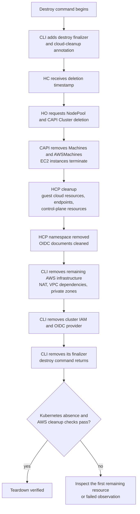

# AWS Hosted Cluster Teardown Roadmap

Startup and teardown have different completion gates. This page describes
normal AWS deletion through the HyperShift CLI, HO, CAPI, CPO, and AWS APIs.
Use it with the [startup roadmap](cluster-startup-roadmap.md) and the measured
[two clean lifecycle observations](cluster-startup-aws-repeat.md).

## Deletion workstreams



This is a dependency model, not a strictly serial trace of every resource.
Cloud cleanup can overlap controller cleanup. The CLI finalizer keeps the HC
present while infrastructure cleanup continues, so an HC that still exists
after the HCP namespace disappears is not automatically stuck.

The relevant code is in `cmd/cluster/core/destroy.go`,
`cmd/cluster/aws/destroy.go`,
`hypershift-operator/controllers/hostedcluster/hostedcluster_controller.go`,
and the provider and HCP deletion reconcilers. Image revisions may differ from
the checkout; retain the HO, CPO, and collector revisions with observations.

## What to inspect next

| Remaining gate | Inspect first |
|----------------|---------------|
| NodePool or CAPI Machines | Machine `Deleting` conditions, AWSMachine finalizers, CAPA logs, EC2 states. `WaitingForInfrastructureDeletion` can be normal while an instance is shutting down. |
| CAPI Cluster or AWSCluster | Remaining Machines, infrastructure conditions, provider errors and finalizers. |
| HCP | CPO cleanup conditions/logs, guest load balancers or storage, endpoint services, service and PVC finalizers. |
| HCP namespace | Namespace conditions and remaining resource finalizers; distinguish normal termination from a discovery failure. |
| NAT gateway | AWS state: `deleting` is still pending; terminal `deleted` is cleanup for this resource. |
| VPC or network dependencies | ENIs, VPC endpoints, subnets, route tables, security groups, internet gateway and Elastic IP. |
| IAM/OIDC | Cluster-prefixed roles and profiles, the exact OIDC provider, and only the cluster's S3 key prefix. |
| HC with only the CLI destroy finalizer | Destroy command progress and remaining AWS infrastructure. |
| A failed query | Authentication, permissions, throttling or API connectivity; failed observation is not evidence that a resource was deleted. |

In both clean observations, internet-gateway detachment temporarily reported
`DependencyViolation` for mapped public addresses while the NAT gateway was
still `deleting`. The normal CLI retry completed cleanup. Inspect NAT state
and remaining dependencies for progress before treating this message as a
permanent failure.

Do not remove finalizers to improve an observed timing. The normal cleanup
path is the subject of these measurements.

## Measuring teardown

Start `hack/cluster-teardown-timeline.py` **before** the destroy command. Supply
an explicit management kubeconfig, HC UID, infrastructure ID, worker VPC ID,
OIDC bucket and exact provider ARN, and a fresh output directory. The collector
is read-only. It records metadata and status, not Kubernetes Secret data.

The collector requires Python 3.11 or later, `oc`, the AWS CLI, and read access
to the listed resources. Use a dedicated HC namespace: the NodePool inventory
covers all NodePools in the supplied namespace. For example:

```bash
python3 hack/cluster-teardown-timeline.py \
  --kubeconfig "$KUBECONFIG" \
  --namespace "$HC_NAMESPACE" --name "$HC_NAME" --uid "$HC_UID" \
  --infra-id "$INFRA_ID" --vpc-id "$WORKER_VPC_ID" \
  --oidc-bucket "$OIDC_BUCKET" --oidc-provider-arn "$OIDC_PROVIDER_ARN" \
  --region us-east-1 --interval 10 --timeout 3600 \
  --output-dir "$CAPTURE_DIR/teardown" \
  --command-state-file "$CAPTURE_DIR/teardown/command.json"
```

Wait until `ready.json` reports `allQueriesSucceeded=true`, then invoke the
guarded copied destroy script. The command wrapper writes a separate JSON
state file with `startedAt` immediately before invocation, followed by
`finishedAt` and `exitCode` on return. This supplies a command-start clock that
includes credential refresh and CLI setup. API deletion timestamps are
recorded separately.

The collector reads the command state file through `--command-state-file`.
A completed example has this shape:

```json
{
  "startedAt": "2026-10-28T21:00:00.000+00:00",
  "finishedAt": "2026-10-28T21:07:00.000+00:00",
  "exitCode": 0
}
```

Retain `observations.jsonl`, `latest.json`, `summary.json`, and the destroy
command log. Each observation includes query start/end times, normalized
Kubernetes finalizers and conditions, AWS resource identities and states,
and first observed cleanup milestones. Per-resource deletion timestamps can
be compared with the first successful absence observation.

For pods, `deletionTimestamp` can be a future grace-period deadline rather than
the time deletion was requested. Retain `deletionGracePeriodSeconds` and
`terminationGracePeriodSeconds` and distinguish first observed termination,
the grace deadline, and first observed absence. A terminating API-server pod
can explain a namespace wait without a stuck finalizer.

Read namespace conditions alongside the actual remaining objects. In the
second clean observation, conditions reported no remaining content while
terminating API-server pods and component API objects were still readable.
The collector's absence checks remain pending until those objects disappear.

The AWS inventory includes worker-VPC resources and control-plane load
balancers discovered through HCP Service DNS names. It retains tracked Elastic
IP, worker-volume, internet-gateway, target-group and private-zone identities
through detachment so detachment alone does not count as deletion.

## Teardown completion

The collector requires a successful destroy command and successful absence
checks for the HC, NodePools, HCP, Machines, AWSMachines, CAPI/AWS clusters,
control-plane components, pods, Services, PVCs, and HCP namespace. It also
checks tracked AWS infrastructure, IAM/OIDC resources, and OIDC documents.
Instances in `terminated` and NAT gateways in `deleted` count as terminal even
if AWS still retains their records.

Deletion milestones use the first successful polling observation unless an
API timestamp is explicitly available. Cloud consistency and polling add
uncertainty; command return and verified absence are separate milestones.
These checks cover the resources inventoried for this test, not an account-wide
proof that no unrelated resource exists. Shared HO installation, management
cluster, OIDC bucket, and base-domain hosted zone remain in place.
